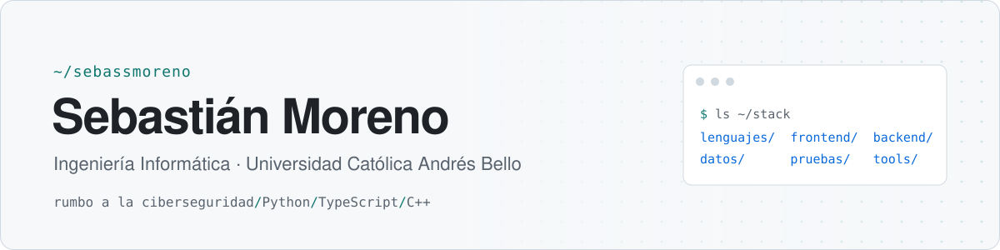

<picture>
  <source media="(prefers-color-scheme: dark)" srcset="./assets/header-dark.svg">
  
</picture>

**🎓 Ingeniería Informática @ UCAB** &nbsp;|&nbsp; **📱 Apps móviles y web** &nbsp;|&nbsp; **🤖 Desarrollo asistido por IA**

 

#### Enfoque

<table>
  <tr>
    <td width="50%">📱 Apps móviles con Flutter  🌐 Web con React, Next.js y PWA  ⚙️ APIs con NestJS y GraphQL</td>
    <td width="50%">🧪 Pruebas automatizadas desde el inicio  📝 Decisiones de diseño documentadas  🤖 Flujo de trabajo con Claude Code</td>
  </tr>
</table>

 

#### Stack

<table>
  <tr>
    <td><b>Lenguajes</b></td>
    <td> también <code>SQL</code> · <code>PL/SQL</code></td>
  </tr>
  <tr>
    <td><b>Frontend y móvil</b></td>
    <td> también <code>Preact</code> · <code>PWA</code></td>
  </tr>
  <tr>
    <td><b>Backend</b></td>
    <td></td>
  </tr>
  <tr>
    <td><b>IA</b></td>
    <td><code>Claude Code</code> · <code>Claude API</code> · <code>Gemini API</code></td>
  </tr>
  <tr>
    <td><b>Datos</b></td>
    <td> también <code>Oracle</code> · <code>IndexedDB</code></td>
  </tr>
  <tr>
    <td><b>Pruebas</b></td>
    <td> también <code>pytest</code></td>
  </tr>
  <tr>
    <td><b>Herramientas</b></td>
    <td> también <code>ESLint</code> · <code>Prettier</code></td>
  </tr>
</table>

 

#### Proyectos destacados

**Mi Pana Académico** · 🚧 *en desarrollo* · 🔒 — App móvil para estudiantes de la UCAB que calcula notas, asistencia y horario, y funciona sin conexión. La meta es publicarla en la App Store. 
`Flutter` · `Dart` · `SQLite` · iOS y Android

**Te Cambio** · 🔒 · [ver demo ↗](https://te-cambio.pages.dev) — PWA para registrar compras y ventas de dólares y saber a qué precio conviene vender sin perder contra el costo promedio. 
`TypeScript` · `Preact` · `Vite` · `IndexedDB` · `Vitest`

**Thinkdy** · 🔒 — App de estudio: subes un PDF, Claude lo organiza por temas y te hace exámenes con nota sobre 20, con repaso de tus errores. 
`React` · `TypeScript` · `Claude API` · `Gemini API` · `IndexedDB`

**[SmartFetch](https://github.com/sebassmoreno/smartfetch)** — Wrapper de `fetch` con timeout, reintentos con backoff e interceptores, sin dependencias. 
`TypeScript` · `Jest` · patrones Strategy y Factory

**[Task Manager GraphQL](https://github.com/sebassmoreno/task-manager-graphql)** — API GraphQL de gestión de tareas con programación orientada a aspectos. 
`NestJS` · `GraphQL` · `TypeScript` · `Winston`

 

#### Otros proyectos

<table>
  <tr>
    <td><b>Radar de Estacionamientos UCAB</b> 🔒</td>
    <td>Web que muestra qué estacionamientos de la UCAB tienen puestos libres, con semáforo de ocupación. Proyecto en equipo.</td>
    <td><code>Next.js</code> · <code>React</code></td>
  </tr>
  <tr>
    <td><b>RutasVenezuela</b> 🔒</td>
    <td>Base de datos relacional y app web para rutas turísticas y culturales de Venezuela. Proyecto en equipo.</td>
    <td><code>SQL</code> · <code>PL/SQL</code> · <code>Oracle</code></td>
  </tr>
  <tr>
    <td><b>La Casa de los Útiles</b> 🔒</td>
    <td>Catálogo web para tiendas de equipos de cocina profesional, con lista de cotización que se envía por WhatsApp.</td>
    <td><code>Astro</code> · <code>TypeScript</code> · <code>Vitest</code></td>
  </tr>
  <tr>
    <td><b>Cotízate</b> 🔒</td>
    <td>App de cotizaciones; hoy en prototipo navegable con el alcance del producto documentado.</td>
    <td><code>HTML</code> · <code>JavaScript</code> · <code>Python</code></td>
  </tr>
  <tr>
    <td><b>Flujo de Caja · Colegio Madison</b> 🔒</td>
    <td>Diseño completo de una app para registrar ingresos y egresos de un colegio con tres sedes: 67 decisiones documentadas antes del código.</td>
    <td>diseño de software</td>
  </tr>
  <tr>
    <td><b>Organizador de archivos</b> 🔒</td>
    <td>Herramienta de línea de comandos para macOS que ordena Descargas y Escritorio y guarda un índice de cada movimiento.</td>
    <td><code>Python</code> · <code>SQLite</code> · <code>pytest</code></td>
  </tr>
</table>

🔒 Código privado. Si quieres ver alguno, escríbeme y te doy acceso.

 

#### Certificaciones

**[Claude From Zero](https://coursera.org/verify/THAY8VG9P0HL)** — Pragmatic AI Labs · Coursera · septiembre 2026 
Claude Code · skills y subagentes · hooks de pre-commit como controles de calidad

 

<i>«Cada decisión, con su porqué.»</i>

